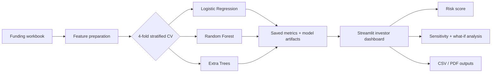
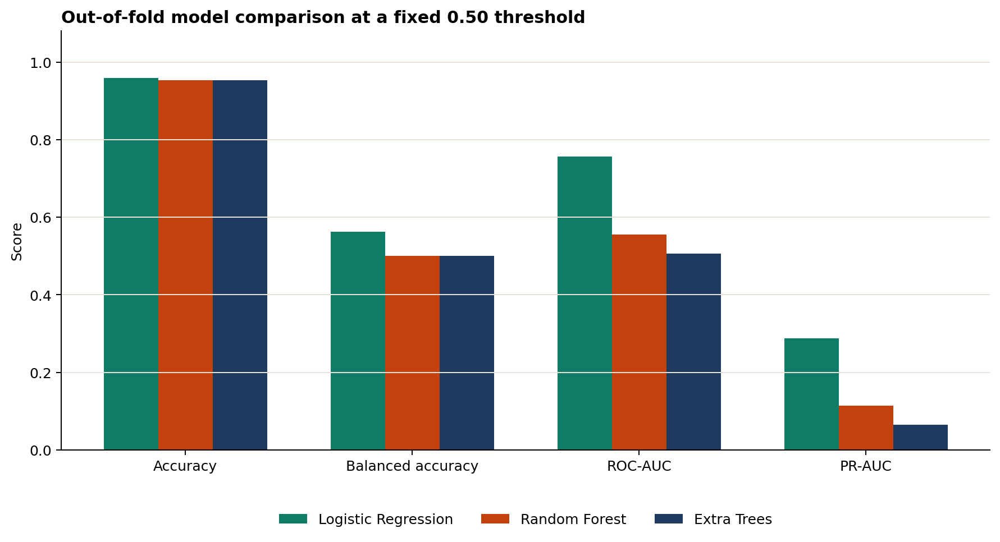
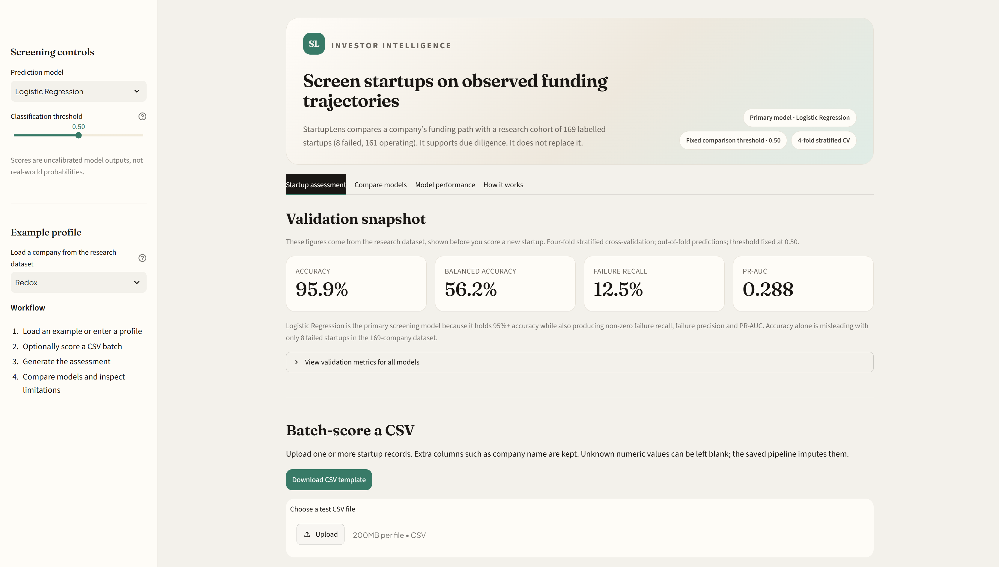

# StartupLens — AI Investor Intelligence Dashboard


StartupLens is a modern, interactive Streamlit dashboard for exploring startup funding signals, assessing company-level risk, and comparing three machine-learning classifiers for an operating-versus-failed startup label.

This repository packages the dashboard, reproducible training and prediction scripts, saved evaluation outputs, source workbook, presentation screenshots, report figures, and academic report.

## System architecture



## Visual walkthrough

The repository includes dashboard screenshots and presentation-ready charts so the project can be reviewed without installing the app first.





## What to look at first

- `app/app.py` — interactive dashboard
- `app/train_compare.py` — model training and 4-fold out-of-fold evaluation
- `app/predict.py` — batch prediction from a CSV template
- `docs/figures/` — clean summary charts for the project report
- `docs/screenshots/` — dashboard and report screenshots
- `app/evaluation_report.json` — evaluation protocol and limitations

## Run the dashboard

From the repository root in PowerShell:

```powershell
python -m pip install -r app/requirements.txt
python -m streamlit run app/app.py
```

Or double-click `app/run_app.bat` after installing the requirements.

## Reproduce the analysis

```powershell
python app/train_compare.py
python scripts/generate_charts.py
```

The training script uses the supplied workbook and produces out-of-fold predictions, comparison metrics, fold-level metrics, model artifacts, and an Excel summary in `app/`.

To score new startups, fill in `app/new_startups_template.csv` and run:

```powershell
python app/predict.py --input app/new_startups_template.csv --output startup_predictions.csv
```

## Evaluation snapshot

The current evaluation uses 169 companies, including 161 operating and 8 failed startups. It uses 4-fold stratified cross-validation, a fixed 0.50 classification threshold, and out-of-fold predictions. Logistic Regression is the primary deployment candidate in the dashboard.

Because there are only 8 failed examples, failure metrics are uncertain and should be treated as exploratory rather than as evidence of production-grade generalisation. The scores are not calibrated real-world probabilities, and the dataset does not establish a strict historical prediction cutoff.

## Project structure

```text
app/       Streamlit app, training/prediction code, models, metrics, templates
data/      Source workbook used by the model comparison
docs/      Screenshots, report assets, and presentation-ready figures
scripts/   Small reproducibility utilities
```

## Academic note

This project is intended for investor-research and classroom demonstration. It supports due diligence; it does not replace investment, legal, or financial advice.
